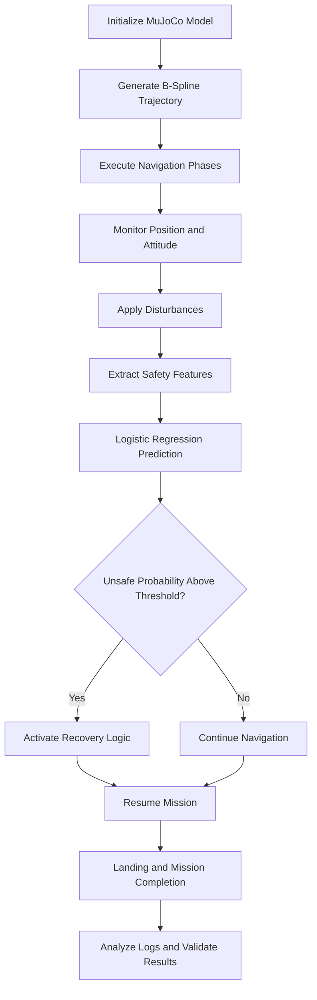
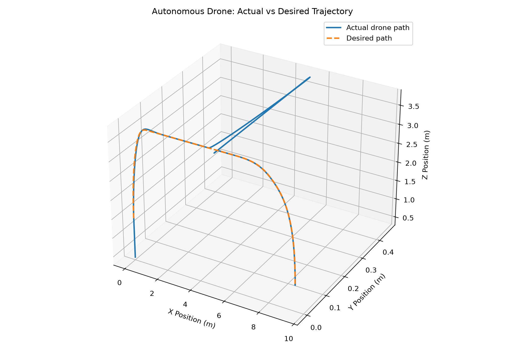
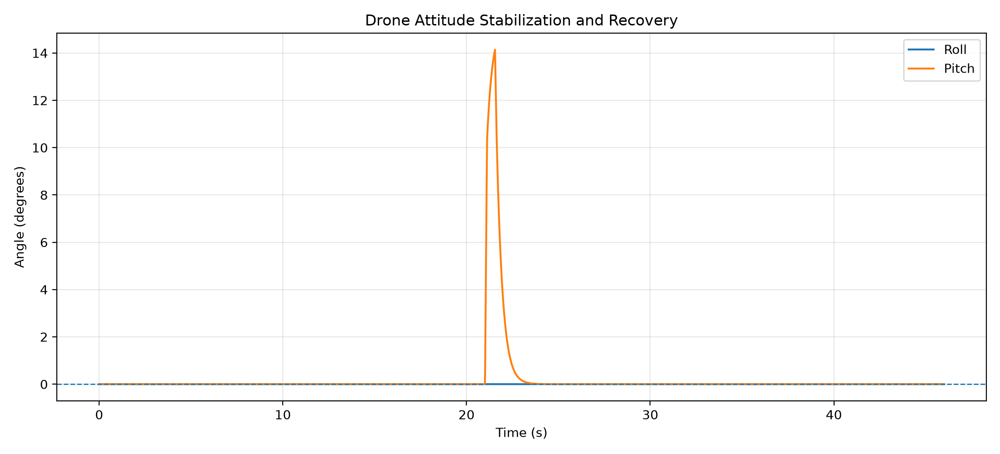
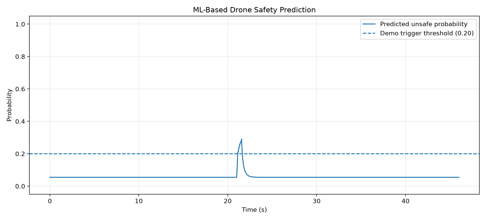

# Autonomous Drone Navigation, B-Spline Trajectory Planning, and ML-Assisted Safety Recovery Using MuJoCo

<p align="center">
  
</p>

<p align="center">
  <strong>Amrita Vishwa Vidyapeetham</strong><br>
  School of Artificial Intelligence<br>
  Coimbatore, Tamil Nadu, India
</p>

---

## Team Members

| S. No. | Name | Roll Number | Email |
|---|---|---|---|
| 1 | P. Myagi Ranganadh | CB.SC.U4AIE24143 | patimamyagi@gmail.com |
| 2 | Devi Sri | CB.SC.U4AIE24163 | chodagiridevisri@gmail.com |
| 3 | Monisha | CB.SC.U4AIE24157 | To be added |

## Abstract

Autonomous drone navigation requires trajectory planning, motion control, obstacle awareness, disturbance handling, and safety monitoring. This project presents a simulation-based autonomous drone navigation and safety-recovery demonstration using the MuJoCo physics engine and Python.

The system integrates cubic B-spline trajectory generation, waypoint-based navigation, attitude monitoring, disturbance simulation, logistic regression-based safety prediction, and recovery logic. The simulated mission includes takeoff, hovering, obstacle clearance, navigation through multiple target phases, wind disturbance, attitude disturbance, safety prediction, recovery, and landing.

The recorded simulation lasted approximately 46 seconds and generated 1,601 sampled B-spline trajectory points. The validation output reported zero sampled path points inside inflated obstacle boxes, zero recorded contact events, zero obstacle-contact steps, zero floor-contact steps, and zero penetration steps. The maximum tracking error was 1.0500 m, the maximum absolute pitch was 14.139 degrees, and 53 unsafe prediction steps and 53 recovery-active steps were recorded.

These results demonstrate the implemented simulation workflow under the tested conditions. They do not establish real-world flight readiness, continuous collision-free motion, or general machine-learning predictive accuracy. The classifier uses synthetic labels, and the current full demo applies body-level forces and torques rather than modelling individual quadrotor motors.

**Keywords:** Autonomous Drone, MuJoCo, B-Spline Trajectory Planning, PID Control, Obstacle Avoidance, Logistic Regression, Safety Prediction, Attitude Recovery.

## 1. Introduction

### 1.1 Background

Autonomous drones must follow desired paths while maintaining stability and responding to obstacles and disturbances. Trajectory planning determines the intended path, while control algorithms influence the drone's motion. Safety monitoring can help identify potentially unsafe states and activate a recovery response.

Physics-based simulation provides a controlled environment for developing and testing these functions before considering physical deployment.

### 1.2 Problem Statement

The objective is to develop a simulated autonomous drone workflow that generates a smooth navigation trajectory, follows a multi-phase mission, encounters disturbances, predicts potentially unsafe conditions, and executes recovery logic before completing the mission.

### 1.3 Objectives

- Develop a drone simulation using MuJoCo and Python.
- Generate a smooth cubic B-spline trajectory.
- Simulate takeoff, hovering, obstacle clearance, target navigation, and landing.
- Introduce wind and attitude disturbances.
- Integrate logistic regression-based safety prediction.
- Activate recovery logic according to the configured safety condition.
- Record trajectory, attitude, collision, and flight-log results.
- Validate the recorded run using the available analysis scripts.

### 1.4 Scope

This project is a simulation-based prototype. Physical drone testing, real sensor integration, validation against real flight data, and proof of continuous collision avoidance are outside the demonstrated scope.

## 2. System Architecture



**Figure 1.** Architecture of the simulated drone navigation and safety-recovery workflow.

## 3. Methodology

### 3.1 Simulation Environment

MuJoCo is used to simulate the drone and environment. Python scripts generate the trajectory, coordinate the mission phases, apply control inputs and disturbances, and collect simulation results.

The main demonstration is implemented in `full_drone_demo.py`. Supporting scripts handle validation, collision checking, attitude tests, and result visualization.

### 3.2 Cubic B-Spline Trajectory Planning

A B-spline is a piecewise polynomial curve that can be used to represent a smooth path.

The trajectory is represented as

$$
\mathbf{P}(u)=\sum_{i=0}^{n}N_{i,p}(u)\mathbf{P}_i
$$

where $\mathbf{P}(u)$ is the trajectory position, $\mathbf{P}_i$ are control points, $N_{i,p}(u)$ are B-spline basis functions, $u$ is the curve parameter, and $p$ is the degree.

The implemented trajectory uses a cubic B-spline:

$$
p=3
$$

The degree-zero basis functions are

$$
N_{i,0}(u)=
\begin{cases}
1, & u_i\leq u<u_{i+1}\\
0, & \text{otherwise}
\end{cases}
$$

For degree $p\geq1$, the Cox–de Boor recursion is

$$
\begin{aligned}
N_{i,p}(u)
={}&\frac{u-u_i}{u_{i+p}-u_i}N_{i,p-1}(u)\\
&+\frac{u_{i+p+1}-u}{u_{i+p+1}-u_{i+1}}
N_{i+1,p-1}(u).
\end{aligned}
$$

Terms with zero denominators are treated as zero.

The sampled path length can be approximated by

$$
L\approx\sum_{k=0}^{N-1}
\left\|\mathbf{P}_{k+1}-\mathbf{P}_k\right\|_2
$$

The current simulation generated 1,601 sampled B-spline points. Sampling supports visualization and collision checks, but does not prove continuous collision avoidance.

### 3.3 Obstacle Representation and Collision Checking

Obstacle boxes are expanded using a safety margin before checking sampled trajectory points.

For an axis-aligned obstacle with center $\mathbf{c}$, half-extents $\mathbf{h}$, and inflation distance $d$,

$$
\mathbf{h}_{\mathrm{inflated}}=\mathbf{h}+d\mathbf{1}
$$

A point $\mathbf{x}$ lies inside the inflated box when

$$
|x_j-c_j|\leq h_{\mathrm{inflated},j}
$$

for every coordinate axis $j$.

The validation script checks sampled path points and records collision-related outcomes. These checks apply to the tested configuration and do not prove that the complete drone body remains collision-free at every instant.

### 3.4 Position and Attitude Monitoring

The drone's position is represented by

$$
\mathbf{p}=
\begin{bmatrix}
x\\y\\z
\end{bmatrix}
$$

Its attitude is represented by

$$
\boldsymbol{\eta}=
\begin{bmatrix}
\phi\\\theta\\\psi
\end{bmatrix}
$$

where $\phi$ is roll, $\theta$ is pitch, and $\psi$ is yaw.

Position tracking error is

$$
\mathbf{e}_p(t)=
\mathbf{p}_{\mathrm{ref}}(t)-\mathbf{p}(t)
$$

Attitude error is

$$
\mathbf{e}_{\eta}(t)=
\boldsymbol{\eta}_{\mathrm{ref}}(t)-\boldsymbol{\eta}(t)
$$

For angular differences, appropriate angle wrapping should be used.

### 3.5 PID Control

A PID controller combines proportional, integral, and derivative responses to the control error:

$$
u(t)=K_p e(t)
+K_i\int_0^t e(\tau)\,d\tau
+K_d\frac{de(t)}{dt}
$$

Here, $K_p$, $K_i$, and $K_d$ represent the proportional, integral, and derivative gains.

A discrete-time approximation is

$$
I_k=I_{k-1}+e_k\Delta t
$$

$$
D_k\approx\frac{e_k-e_{k-1}}{\Delta t}
$$

$$
u_k=K_p e_k+K_i I_k+K_dD_k
$$

These equations explain the PID principle. The actual gains and control implementation must be verified from the project's controller source files.

**Implementation limitation:** The current full demonstration applies body-level forces and torques through MuJoCo's `data.xfrc_applied` interface. It is not a complete four-rotor actuation model.

### 3.6 Wind Disturbance

A wind-disturbance phase is included between approximately 16 and 21 seconds.

The configured force disturbance is

$$
\mathbf{F}_{\mathrm{wind}}=
\begin{bmatrix}
0.45\\
1.8\\
0
\end{bmatrix}
$$

This is a configured simulation force, not a measured real-world wind speed.

### 3.7 Attitude Disturbance and Recovery

An attitude-related torque disturbance is introduced during the safety phase:

$$
\boldsymbol{\tau}_{\mathrm{disturbance}}=
\begin{bmatrix}
0\\
4.0\\
0
\end{bmatrix}
$$

The configured recovery condition is

$$
\mathrm{recovering}=
\left(p_{\mathrm{unsafe}}\geq0.20\right)
\land
\left(21.0\leq t<27.0\right)
$$

where $p_{\mathrm{unsafe}}$ is the predicted unsafe probability.

The threshold is specific to this demonstration and has not been established as a suitable threshold for real flight.

### 3.8 Logistic Regression Safety Prediction

Logistic regression estimates the probability of an unsafe state from a feature vector:

$$
p(y=1\mid\mathbf{x})=
\frac{1}{1+\exp\left[-(b+\mathbf{w}^{\top}\mathbf{x})\right]}
$$

Here, $\mathbf{x}$ represents input features, $\mathbf{w}$ is the coefficient vector, and $b$ is the intercept.

The current classifier uses synthetic labels. It demonstrates the integration of a machine-learning prediction with the recovery logic, but its accuracy on real drone data has not been established.

### 3.9 Mission Phases

| Time | Mission phase |
|---|---|
| 0–3 s | Takeoff |
| 3–5 s | Hover and stabilize |
| 5–8 s | Climb above obstacles |
| 8–12 s | Target 1 navigation |
| 12–16 s | Target 2 navigation |
| 16–21 s | Wind and position-hold phase |
| 21–27 s | Attitude safety and recovery |
| 27–34 s | Final target navigation |
| 34–46 s | Landing and target reached |

The configured final target is

$$
\mathbf{p}_{\mathrm{goal}}=
\begin{bmatrix}
9.5\\
0\\
1.0
\end{bmatrix}
$$

### 3.10 Observability and Controllability

For a linear state-space model,

$$
\dot{\mathbf{x}}=A\mathbf{x}+B\mathbf{u}
$$

$$
\mathbf{y}=C\mathbf{x}
$$

the observability matrix is

$$
\mathcal{O}=
\begin{bmatrix}
C\\
CA\\
CA^2\\
\vdots\\
CA^{n-1}
\end{bmatrix}
$$

The controllability matrix is

$$
\mathcal{C}=
\begin{bmatrix}
B & AB & A^2B & \cdots & A^{n-1}B
\end{bmatrix}
$$

For an $n$-state model, full observability and controllability require the respective matrices to have rank $n$.

A verified numerical analysis requires defined state-space matrices. The current measured results do not include a completed rank calculation, so no numerical observability or controllability claim is made here.

## 4. Implementation

The repository contains the main simulation, model definitions, validation scripts, control-related tests, navigation utilities, and results.

| File or folder | Purpose |
|---|---|
| `full_drone_demo.py` | Main simulation |
| `full_drone_demo_backup.py` | Backup simulation |
| `drone_full_demo.xml` | Full-demo XML model |
| `drone_model.xml` | Drone model |
| `main.py` | Additional project entry point |
| `viewer_demo.py` | Viewer demonstration |
| `attitude_controller_test.py` | Attitude controller testing |
| `attitude_test.py` | Attitude testing |
| `check_collisions.py` | Collision checks |
| `check_full_flight_collisions.py` | Full-flight collision validation |
| `check_phase_performance.py` | Phase analysis |
| `validate_drone.py` | Validation script |
| `validate_drone_backup.py` | Backup validation script |
| `analyze_flight_results.py` | Flight-result analysis |
| `create_final_graphs.py` | Result-plot generation |
| `navigation/` | Navigation modules |
| `control/` | Control modules |
| `analysis/` | Analysis utilities |
| `sensors/` | Sensor-related modules |
| `results/` | Generated logs, plots, and trajectory data |
| `requirements.txt` | Python dependencies |

## 5. Experimental Setup

The following values are taken from the available simulation and validation output.

| Parameter | Recorded value |
|---|---:|
| Simulation duration | Approximately 46 s |
| Simulation time step | 0.0100 s |
| Simulation steps | 4,600 |
| B-spline degree | 3 |
| B-spline samples | 1,601 |
| Drone geometry count | 3 |
| Obstacle geometry count | 3 |
| Final target | $(9.5,0,1.0)$ |
| Unsafe prediction steps | 53 |
| Recovery-active steps | 53 |

These values describe the recorded run, not a statistical evaluation across multiple trials.

## 6. Results and Discussion

**The figures in this section are intended to be generated by the project. They are not reference images from the internet.**

### 6.1 Actual Simulated Drone Trajectory



**Figure 2.** Trajectory plot generated by the simulation.

### 6.2 Actual Attitude Response



**Figure 3.** Attitude plot generated from the project's simulation results.

### 6.3 Actual Safety Prediction and Recovery Results



**Figure 4.** Safety-related plot generated by the project.

### 6.4 Quantitative Results

| Metric | Actual recorded result |
|---|---:|
| Simulation duration | 46.00 s |
| Simulation steps | 4,600 |
| Time step | 0.0100 s |
| B-spline samples | 1,601 |
| Sampled points inside inflated obstacle boxes | 0 |
| Recorded contact events | 0 |
| Obstacle-contact steps | 0 |
| Floor-contact steps | 0 |
| Penetration steps | 0 |
| Maximum tracking error | 1.0500 m |
| Maximum absolute roll | 0.000° |
| Maximum absolute pitch | 14.139° |
| Unsafe prediction steps | 53 |
| Recovery-active steps | 53 |
| Minimum drone-center height | 0.3500 m |
| Maximum drone-center height | 3.8290 m |

### 6.5 Trajectory Discussion

The generated trajectory contained 1,601 sampled points. The validation output reported zero sampled points inside inflated obstacle boxes. This supports the geometric clearance result for the tested samples but does not prove continuous collision avoidance for the full drone body.

The maximum recorded tracking error was 1.0500 m, indicating that the simulated drone did not coincide exactly with the reference trajectory throughout the run.

### 6.6 Attitude Discussion

The maximum absolute pitch was 14.139 degrees, while the maximum absolute roll reported by the validation script was 0.000 degrees.

These values describe the recorded simulation. Additional runs with different disturbances and independent verification of the attitude dynamics would be required to establish robust attitude stabilization.

### 6.7 Safety and Recovery Discussion

The validation output recorded 53 unsafe prediction steps and 53 recovery-active steps. This demonstrates activation of the configured safety and recovery logic in the current run.

Because the classifier uses synthetic labels and the recovery condition includes a specific time window, these results do not establish the predictive accuracy of a real-world safety system.

### 6.8 Collision Validation

The validation output reported zero contact events, zero obstacle-contact steps, zero floor-contact steps, and zero penetration steps. These are results from the tested configuration and do not guarantee collision-free behavior under all trajectories, disturbances, or model settings.

## 7. Generated Results and Data

The project generates the following result files:

| File | Description |
|---|---|
| `results/final_trajectory.png` | Generated trajectory plot |
| `results/final_attitude.png` | Generated attitude plot |
| `results/final_safety.png` | Generated safety plot |
| `results/trajectory.png` | Additional trajectory plot |
| `results/attitude.png` | Additional attitude plot |
| `results/bspline_trajectory.csv` | Sampled trajectory data |
| `results/drone_flight_log.csv` | Flight and simulation log |
| `results/drone_collision_events.csv` | Collision-event output |
| `results/flight_validation_summary.txt` | Validation summary |

The README image paths refer to local repository files. If a file is missing or has a different filename, regenerate the plot or update the image path to match the actual file.

## 8. How to Run the Project

### 8.1 Requirements

- Python version compatible with the dependencies in `requirements.txt`.
- MuJoCo Python bindings.
- Packages listed in `requirements.txt`.
- A graphical environment if the simulation uses the MuJoCo viewer.

### 8.2 Clone the Repository

```bash
git clone https://github.com/myagi548/Drones_S5_AB14_BSpline_PID_ML_Safety.git
cd Drones_S5_AB14_BSpline_PID_ML_Safety
```

### 8.3 Install Dependencies

On Windows PowerShell:

```powershell
python -m venv .venv
.\.venv\Scripts\Activate.ps1
python -m pip install --upgrade pip
pip install -r requirements.txt
```

If an existing Conda environment already contains the required packages, activate that environment instead.

### 8.4 Run the Main Simulation

```powershell
python full_drone_demo.py
```

### 8.5 Run Validation and Analysis

Run these commands from the repository root, checking each output before continuing.

```powershell
python validate_drone.py
```

```powershell
python check_full_flight_collisions.py
```

```powershell
python analyze_flight_results.py
```

```powershell
python create_final_graphs.py
```

Check the terminal output for errors and confirm that the expected result files are created.

## 9. Limitations and Future Work

### 9.1 Limitations

1. The logistic regression classifier uses synthetic labels and has not been validated against real flight data.
2. The current full demo applies body-level forces and torques rather than modelling individual rotor motors.
3. Discrete path-point checks do not prove continuous collision avoidance for the complete drone geometry.
4. The maximum recorded tracking error is 1.0500 m and warrants further investigation.
5. The reported results come from the available run rather than repeated statistical trials.
6. No verified numerical observability or controllability rank analysis is included.
7. Real-world performance and flight safety have not been established.

### 9.2 Future Improvements

- Train and evaluate the classifier using representative, independently labelled flight data.
- Report confusion-matrix counts, precision, recall, F1-score, and probability calibration.
- Implement individual rotor thrust and reaction-torque dynamics.
- Improve trajectory tracking and document controller gains.
- Add swept-volume or continuous collision checking.
- Test multiple obstacle arrangements, target locations, and disturbance strengths.
- Perform a numerical observability and controllability analysis using a defined state-space model.
- Repeat experiments and compare results across multiple runs.
- Generate an animation showing the drone, trajectory, obstacles, disturbances, prediction, and recovery.
- Perform physical testing only after appropriate hardware and safety validation.

## 10. Conclusion

This project demonstrates a simulation-based autonomous drone workflow using cubic B-spline trajectory generation, mission-phase navigation, disturbance simulation, attitude monitoring, logistic regression-based safety prediction, and recovery logic.

The recorded run lasted approximately 46 seconds and included 1,601 sampled B-spline points. The validation output reported zero sampled points inside inflated obstacle boxes, zero recorded contact events, zero obstacle-contact steps, zero floor-contact steps, and zero penetration steps. The maximum tracking error was 1.0500 m, the maximum absolute pitch was 14.139 degrees, and 53 unsafe prediction steps coincided with 53 recovery-active steps.

The results demonstrate integration of the implemented components under the tested configuration. However, synthetic classifier labels, body-level force and torque control, nonzero tracking error, and the limitations of sampled collision checks mean that the system should be treated as a simulation prototype rather than a flight-validated autonomous drone.

## 11. References

These references provide background for the technologies and mathematical methods used in the project. They are not claimed to be the confirmed base paper.

1. Todorov, E., Erez, T., and Tassa, Y. (2012). *MuJoCo: A Physics Engine for Model-Based Control.* IEEE/RSJ International Conference on Intelligent Robots and Systems (IROS).  
   https://doi.org/10.1109/IROS.2012.6386109

2. Google DeepMind. *MuJoCo Documentation.*  
   https://mujoco.readthedocs.io/

3. Google DeepMind. *MuJoCo Source Repository.*  
   https://github.com/google-deepmind/mujoco

4. de Boor, C. (1978). *A Practical Guide to Splines.* Springer.  
   https://doi.org/10.1007/978-1-4612-6333-3

5. scikit-learn Developers. *LogisticRegression Documentation.*  
   https://scikit-learn.org/stable/modules/generated/sklearn.linear_model.LogisticRegression.html

6. Amrita Vishwa Vidyapeetham. *Official Website.*  
   https://www.amrita.edu/

7. Amrita Vishwa Vidyapeetham Logo. *Wikimedia Commons.*  
   https://commons.wikimedia.org/wiki/File:Amrita-vishwa-vidyapeetham-logo.svg

**Base research paper:** Not provided. Add the confirmed paper title, DOI, or official link when it becomes available.

---

## Repository

**GitHub:** https://github.com/myagi548/Drones_S5_AB14_BSpline_PID_ML_Safety

**Institution:** Amrita Vishwa Vidyapeetham, School of Artificial Intelligence, Coimbatore, India.
