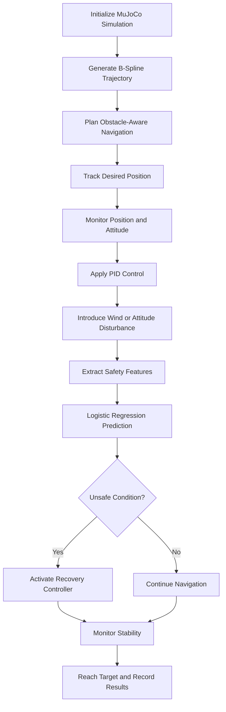

# Autonomous Drone Navigation, B-Spline Trajectory Planning, and ML-Assisted Safety Recovery Using MuJoCo

<p align="center">
  
</p>

## Team Members

| Name | Register Number | Email |
|---|---|---|
| P. Myagi Ranganadh | CB.SC.U4AIE24143 | patimamyagi@gmail.com |
| Devi Sri | CB.SC.U4AIE24163 | chodagiridevisri@gmail.com |
| Monisha | CB.SC.U4AIE24157 | To be added |

---

## Abstract

This project presents an autonomous drone navigation and safety monitoring system developed using MuJoCo and Python. The system combines cubic B-spline trajectory planning, obstacle avoidance, PID-based control, attitude monitoring, and machine-learning-assisted safety prediction.

The simulated drone follows a planned trajectory while navigating around obstacles and moving toward multiple targets. Wind disturbances and attitude disturbances are introduced to evaluate the system's response. A Logistic Regression classifier predicts unsafe flight conditions, and a recovery controller attempts to restore safe flight behavior.

The project evaluates trajectory tracking, obstacle clearance, attitude stability, safety prediction, and recovery performance in a physics-based simulation environment.

## Keywords

Autonomous Drone, MuJoCo, B-Spline Trajectory, Obstacle Avoidance, PID Controller, Logistic Regression, Attitude Recovery, Machine Learning, Drone Simulation.

---

# 1. Introduction

## 1.1 Background

Autonomous drones are used in surveillance, inspection, delivery, mapping, and search-and-rescue applications. These tasks require a drone to navigate through an environment while maintaining stability and avoiding obstacles.

A reliable autonomous drone system needs trajectory planning, flight control, obstacle detection, and safety monitoring. Disturbances such as wind and sudden attitude changes can affect flight stability and cause deviations from the desired trajectory.

This project integrates these components into a simulated drone navigation system using MuJoCo.

## 1.2 Problem Statement

A drone navigating an environment may deviate from its planned path because of obstacles, external disturbances, or unstable attitude. Without suitable monitoring and recovery mechanisms, these deviations can affect navigation performance and safety.

Therefore, this project develops a simulated autonomous drone system that plans collision-aware trajectories, monitors its position and attitude, predicts unsafe conditions using machine learning, and activates a recovery controller when required.

## 1.3 Objectives

- Develop an autonomous drone simulation using MuJoCo.
- Generate smooth trajectories using cubic B-splines.
- Plan navigation paths around obstacles.
- Implement PID-based attitude control.
- Introduce wind and attitude disturbances.
- Predict unsafe flight conditions using Logistic Regression.
- Activate a recovery controller when the safety condition is triggered.
- Evaluate the simulation using trajectory, attitude, and safety results.

## 1.4 Scope

The project focuses on simulation-based autonomous navigation and safety monitoring. It does not demonstrate a real-world drone flight or certify real-world collision avoidance.

---

# 2. System Architecture

The system follows this overall workflow:



## 2.1 Main Components

| Component | Purpose |
|---|---|
| MuJoCo | Physics-based simulation environment |
| B-Spline Planner | Generates smooth reference trajectories |
| Obstacle Planner | Searches for collision-free sampled paths |
| Position Controller | Tracks the desired drone position |
| PID Controller | Computes corrective control commands |
| Disturbance Model | Introduces wind and attitude disturbances |
| Logistic Regression | Predicts unsafe conditions from extracted features |
| Recovery Controller | Attempts to restore safe attitude |
| Results Logger | Records flight data and evaluation metrics |

---

# 3. Methodology

## 3.1 MuJoCo Simulation Environment

MuJoCo is used to simulate the drone and its surrounding environment. The simulation contains the drone, obstacles, a floor, target locations, and control logic.

The simulation state is updated over discrete time steps. At each step, the controller reads the current state, computes control commands, and applies them to the simulated drone.

The simulation uses a time step of approximately 0.01 seconds.

## 3.2 Cubic B-Spline Trajectory Planning

A B-spline is a piecewise polynomial curve used to generate smooth trajectories. It is controlled by control points and a knot vector.

The general B-spline curve is defined as

$$
\mathbf{P}(u)=
\sum_{i=0}^{n}N_{i,p}(u)\mathbf{P}_i
$$

where:

- $\mathbf{P}(u)$ is the point on the curve.
- $\mathbf{P}_i$ is the $i$-th control point.
- $N_{i,p}(u)$ is the B-spline basis function.
- $p$ is the polynomial degree.
- $u$ is the curve parameter.
- $n+1$ is the number of control points.

For a cubic B-spline,

$$
p=3
$$

The degree-zero basis functions are defined as

$$
N_{i,0}(u)=
\begin{cases}
1, & u_i \leq u < u_{i+1},\\
0, & \text{otherwise}.
\end{cases}
$$

Higher-degree basis functions are calculated recursively using the Cox-de Boor formula:

$$
N_{i,p}(u)=
\frac{u-u_i}{u_{i+p}-u_i}N_{i,p-1}(u)
+
\frac{u_{i+p+1}-u}{u_{i+p+1}-u_{i+1}}N_{i+1,p-1}(u)
$$

A term with a zero denominator is treated as zero.

The trajectory is sampled at multiple parameter values to obtain reference positions for navigation.

## 3.3 Obstacle Representation and Path Planning

Obstacles are represented using axis-aligned bounding boxes. A clearance distance is added to the obstacle dimensions to create an inflated obstacle region.

For an obstacle centered at $\mathbf{c}$ with half-extents $\mathbf{h}$, the inflated half-extents are

$$
\mathbf{h}_{inflated}=\mathbf{h}+d_s\mathbf{1}
$$

where $d_s$ is the safety clearance and $\mathbf{1}$ is a vector of ones.

A sampled point $\mathbf{p}$ is inside the inflated box if

$$
|p_x-c_x|\leq h_x+d_s
$$

$$
|p_y-c_y|\leq h_y+d_s
$$

$$
|p_z-c_z|\leq h_z+d_s
$$

If all three conditions are satisfied, the point is considered inside the inflated obstacle region.

The planner evaluates candidate paths against the inflated obstacles and selects a collision-free sampled path when one is available. The selected waypoints are used to construct the navigation trajectory.

This sampled checking approach does not by itself guarantee continuous collision avoidance between every pair of samples or account for the full swept volume of the drone.

## 3.4 Position and Attitude Monitoring

The drone's position is represented by

$$
\mathbf{p}=
\begin{bmatrix}
x\\
y\\
z
\end{bmatrix}
$$

where $x$, $y$, and $z$ represent the drone's position along the three coordinate axes.

The drone's attitude is represented by

$$
\boldsymbol{\eta}=
\begin{bmatrix}
\phi\\
\theta\\
\psi
\end{bmatrix}
$$

where $\phi$ represents roll, $\theta$ represents pitch, and $\psi$ represents yaw.

The position tracking error is

$$
\mathbf{e}_p=
\mathbf{p}_{desired}-\mathbf{p}_{actual}
$$

The attitude tracking error is

$$
\mathbf{e}_{\eta}=
\boldsymbol{\eta}_{desired}-
\boldsymbol{\eta}_{actual}
$$

These errors help evaluate the difference between the desired and actual drone states. The controller uses state information to maintain stability and follow the planned trajectory.

## 3.5 PID Controller

A Proportional-Integral-Derivative controller calculates a corrective control signal using the current error, accumulated error, and rate of change of error.

The continuous PID control law is

$$
u(t)=K_p e(t)+K_i\int_0^t e(\tau)\,d\tau
+K_d\frac{de(t)}{dt}
$$

where:

- $u(t)$ is the control output.
- $e(t)$ is the tracking error.
- $K_p$ is the proportional gain.
- $K_i$ is the integral gain.
- $K_d$ is the derivative gain.

The proportional term responds to the current error. The integral term accounts for accumulated error, while the derivative term responds to the rate at which error changes.

In discrete time, the integral and derivative can be approximated as

$$
I_k=I_{k-1}+e_k\Delta t
$$

$$
D_k=\frac{e_k-e_{k-1}}{\Delta t}
$$

The resulting control command is

$$
u_k=K_p e_k+K_i I_k+K_d D_k
$$

The controller uses the appropriate error signals to compute corrective commands for flight stabilization. Controller performance depends on gain selection, model dynamics, and actuator limitations.

## 3.6 Wind Disturbance

Wind disturbance is introduced to examine how external forces affect navigation and tracking performance.

The configured wind force is

$$
\mathbf{F}_{wind}=
\begin{bmatrix}
0.45\\
1.8\\
0
\end{bmatrix}
$$

The force acts along the configured coordinate directions in the simulation. The controller attempts to maintain the desired state while the disturbance is applied.

The wind scenario is intended to demonstrate the controller's response to a disturbance rather than prove robustness under every possible wind condition.

## 3.7 Attitude Disturbance and Recovery

An external torque is applied to disturb the drone's attitude.

The configured disturbance torque is

$$
\boldsymbol{\tau}_{disturbance}=
\begin{bmatrix}
0\\
4.0\\
0
\end{bmatrix}
$$

The attitude response is monitored during the disturbance. When the safety classifier predicts an unsafe condition and the configured recovery conditions are met, the recovery controller is activated.

The recovery controller attempts to drive the attitude toward the desired stable orientation, usually with desired roll and pitch set to zero.

The simulation records the prediction and recovery activation to evaluate the response.

## 3.8 Machine Learning-Based Safety Prediction

Logistic Regression is used to classify flight conditions as safe or unsafe using the selected input features.

The predicted probability of the unsafe class is calculated as

$$
P(y=1\mid\mathbf{x})=
\frac{1}{1+\exp[-(\mathbf{w}^{T}\mathbf{x}+b)]}
$$

where:

- $\mathbf{x}$ is the feature vector.
- $\mathbf{w}$ is the learned coefficient vector.
- $b$ is the bias term.
- $y=1$ represents the unsafe class.

The classifier's probability is compared against a safety threshold.

In this implementation, the configured threshold is

$$
P_{threshold}=0.20
$$

A prediction at or above this threshold is considered unsafe for the configured recovery logic. Recovery activation also depends on the simulation's configured time window.

The classifier uses synthetic training labels in this project. Its predictions therefore demonstrate the integration of machine learning with the simulation and should not be interpreted as a validated real-flight safety model.

## 3.9 Mission Phases

The main demonstration follows these phases:

| Approximate Time | Mission Phase |
|---|---|
| 0–3 s | Takeoff |
| 3–5 s | Hover and stabilization |
| 5–8 s | Climb above obstacles |
| 8–12 s | Navigate toward target 1 |
| 12–16 s | Navigate toward target 2 |
| 16–21 s | Wind disturbance and position holding |
| 21–27 s | Attitude disturbance and safety recovery |
| 27–34 s | Final target navigation |
| 34–46 s | Landing and target reached |

These intervals describe the configured demonstration sequence.

## 3.10 Observability and Controllability

Observability and controllability are important concepts in control-system analysis.

For a linear system,

$$
\dot{\mathbf{x}}=A\mathbf{x}+B\mathbf{u}
$$

$$
\mathbf{y}=C\mathbf{x}
$$

where $\mathbf{x}$ is the state vector, $\mathbf{u}$ is the input, and $\mathbf{y}$ is the measured output.

The observability matrix is

$$
\mathcal{O}=
\begin{bmatrix}
C\\
CA\\
CA^2\\
\vdots\\
CA^{n-1}
\end{bmatrix}
$$

A linear system is observable if the observability matrix has full rank.

The controllability matrix is

$$
\mathcal{C}=
\begin{bmatrix}
B & AB & A^2B & \cdots & A^{n-1}B
\end{bmatrix}
$$

A linear system is controllable if the controllability matrix has full rank.

These definitions provide a theoretical framework for determining whether internal states can be reconstructed from outputs and whether system states can be influenced by control inputs. A formal observability or controllability claim requires a specified system model and an actual rank analysis; using these concepts alone does not establish that the simulated drone has been proven observable or controllable.

---

# 4. Implementation

The project is implemented in Python and uses MuJoCo for simulation and numerical tools for trajectory planning, control, and machine learning.

| Module | Responsibility |
|---|---|
| Simulation | Creates the drone and environment |
| Navigation | Generates trajectories and checks obstacle clearance |
| Control | Computes position and attitude corrections |
| Prediction | Produces safe/unsafe predictions |
| Sensors and State Monitoring | Provides the current simulation state |
| Experiments | Runs configured scenarios |
| Results | Stores plots, CSV logs, and validation summaries |

The exact filenames and commands depend on the files present in the repository. Refer to the project directory before running individual scripts.

---

# 5. Experimental Setup

The demonstration uses the following configured settings:

| Parameter | Value |
|---|---|
| Simulation environment | MuJoCo |
| Simulation duration | 46 seconds |
| Simulation time step | 0.01 seconds |
| Number of simulation steps | 4600 |
| Trajectory type | Cubic B-spline |
| Number of sampled B-spline points | 1601 |
| Safety probability threshold | 0.20 |
| Wind force | `[0.45, 1.8, 0.0]` |
| Disturbance torque | `[0.0, 4.0, 0.0]` |
| Final target position | `[9.5, 0.0, 1.0]` |

The results listed below describe a recorded run of the configured simulation. Re-run the simulation to reproduce or update the measurements.

---

# 6. Results and Discussion

The recorded simulation summary contains the following measurements:

| Metric | Recorded Result |
|---|---:|
| Duration | 46.00 s |
| Steps | 4600 |
| Time step | 0.0100 s |
| Drone geometry count | 3 |
| Obstacle geometry count | 3 |
| Sampled B-spline points | 1601 |
| Sampled path points inside inflated obstacle boxes | 0 |
| Recorded contact events | 0 |
| Obstacle-contact steps | 0 |
| Floor-contact steps | 0 |
| Penetration steps | 0 |
| Unsafe prediction steps | 53 |
| Recovery-active steps | 53 |
| Minimum center height | 0.3500 m |
| Maximum center height | 3.8290 m |
| Maximum absolute roll | 0.000 degrees |
| Maximum absolute pitch | 14.139 degrees |
| Maximum tracking error | 1.0500 m |

## 6.1 Trajectory Performance

The cubic B-spline provides a smooth reference path for the navigation controller. The sampled path validation recorded zero points inside the inflated obstacle boxes.

This result applies to the sampled points evaluated by the planner. It does not prove continuous collision avoidance or full-body clearance between samples.

## 6.2 Attitude Performance

The recorded run reported a maximum absolute roll of 0.000 degrees and a maximum absolute pitch of 14.139 degrees. These values summarize the recorded attitude signals and should be interpreted alongside the disturbance configuration and the simulation's applied control model.

## 6.3 Safety Prediction and Recovery

The recorded run reported 53 unsafe prediction steps and 53 recovery-active steps. This indicates that the configured recovery logic was active during those recorded steps.

Because the classifier uses synthetic training labels and the recovery logic includes a configured time window, these results do not independently demonstrate real-world safety prediction accuracy.

## 6.4 Limitations

- The drone is evaluated in simulation, not in real-world flight.
- The Logistic Regression classifier is trained using synthetic labels.
- Sampled path checks do not establish continuous collision-free motion.
- Direct body force and torque application is not equivalent to a fully validated four-rotor flight-control model.
- The reported results describe a particular recorded simulation run.
- Further testing is required across different obstacles, trajectories, disturbances, and initial conditions.

---

# 7. Generated Results and Data

The following result files may be included in the repository if generated by the simulation:

| File | Description |
|---|---|
| `results/final_trajectory.png` | Final trajectory visualization |
| `results/final_attitude.png` | Final attitude visualization |
| `results/final_safety.png` | Safety prediction and recovery visualization |
| `results/trajectory.png` | Trajectory plot |
| `results/attitude.png` | Attitude plot |
| `results/bspline_trajectory.csv` | Sampled B-spline trajectory data |
| `results/drone_flight_log.csv` | Recorded flight-state data |
| `results/drone_collision_events.csv` | Recorded collision events |
| `results/flight_validation_summary.txt` | Validation summary |

Only files that actually exist in the repository should be treated as available results.

---

# 8. How to Run

## 8.1 Prerequisites

Install Python and MuJoCo in the appropriate project environment. Additional dependencies may include NumPy, Matplotlib, and scikit-learn, depending on the scripts used.

Activate the environment configured for the project before running the simulation.

## 8.2 Run the Main Demonstration

From the project root directory, run the main demonstration script if it exists:

```powershell
python full_drone_demo.py
```

If the script is located elsewhere or uses a different filename, use the actual path and filename from the repository.

## 8.3 Inspect Results

After a successful run, inspect the generated CSV files, plots, and validation summary in the results directory. Confirm that each output file exists before referencing it in a report.

---

# 9. Future Work

Potential improvements include:

- Training the safety classifier using realistic flight data.
- Evaluating prediction accuracy using precision, recall, F1-score, and a confusion matrix.
- Testing multiple obstacle configurations and different target locations.
- Improving continuous collision checking and accounting for the drone's full geometry.
- Implementing a more complete four-rotor dynamics and control model.
- Evaluating the controller under multiple wind strengths and disturbance directions.
- Performing formal observability and controllability analysis using an explicit system model.
- Testing the approach on hardware only after suitable validation and safety precautions.

---

# 10. Conclusion

This project integrates autonomous navigation, cubic B-spline trajectory planning, obstacle-aware path checking, PID-based control, disturbance simulation, and machine-learning-assisted safety recovery in MuJoCo.

The recorded simulation demonstrates the interaction of trajectory following, attitude monitoring, unsafe-condition prediction, and recovery activation. The results provide a basis for further evaluation, while the limitations highlight the need for realistic training data, more complete dynamics, and stronger collision and control validation before any real-world deployment.

---

# 11. References

1. E. Todorov, T. Erez, and Y. Tassa, “MuJoCo: A Physics Engine for Model-Based Control,” *IEEE/RSJ International Conference on Intelligent Robots and Systems*, 2012. https://doi.org/10.1109/IROS.2012.6386109
2. MuJoCo Documentation. https://mujoco.readthedocs.io/
3. MuJoCo Source Repository. https://github.com/google-deepmind/mujoco
4. C. de Boor, *A Practical Guide to Splines*. Springer, 1978. https://doi.org/10.1007/978-1-4612-6333-3
5. scikit-learn, Logistic Regression Documentation. https://scikit-learn.org/stable/modules/generated/sklearn.linear_model.LogisticRegression.html
6. Amrita Vishwa Vidyapeetham. https://www.amrita.edu/

---

# 12. Repository

GitHub Repository:

https://github.com/myagi548/Drones_S5_AB14_BSpline_PID_ML_Safety
