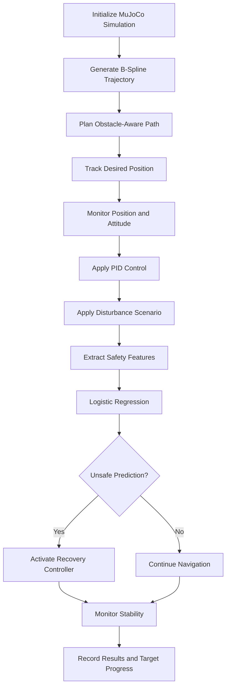

# Autonomous Drone Navigation, B-Spline Trajectory Planning, and ML-Assisted Safety Recovery Using MuJoCo

<p align="center">
  
</p>

## Team Members

| Name | Register Number | Email |
|---|---|---|
| P. Myagi Ranganadh | CB.SC.U4AIE24143 | patimamyagi@gmail.com |
| Devi Sri | CB.SC.U4AIE24163 | chodagiridevisri@gmail.com |
| Monisha | CB.SC.U4AIE24157 | vemurimonisha@gmial.com |

---

## Abstract

This project presents an autonomous drone navigation and safety monitoring system developed using MuJoCo and Python. The system combines cubic B-spline trajectory planning, obstacle-aware navigation, PID-based control, attitude monitoring, and machine-learning-assisted safety prediction.

The simulated drone follows a planned trajectory, navigates around obstacles, and moves toward multiple targets. Wind and attitude disturbances are introduced to evaluate the system response. A Logistic Regression classifier predicts unsafe flight conditions, and a recovery controller attempts to restore stable flight.

The simulation results include trajectory plots, attitude response plots, safety prediction results, flight logs, trajectory data, collision records, and a validation summary.

## Keywords

Autonomous Drone, MuJoCo, B-Spline Trajectory Planning, Obstacle Avoidance, PID Controller, Logistic Regression, Safety Prediction, Attitude Recovery, Machine Learning.

---

# 1. Introduction

## 1.1 Background

Autonomous drones are used in surveillance, inspection, delivery, mapping, and search-and-rescue applications. These applications require drones to navigate through environments while maintaining stability and avoiding obstacles.

A reliable autonomous drone system requires trajectory planning, feedback control, state monitoring, and safety mechanisms. Wind disturbances and sudden attitude changes can cause a drone to deviate from its desired trajectory.

This project integrates navigation, control, and machine-learning-assisted safety monitoring in a MuJoCo simulation.

## 1.2 Problem Statement

During autonomous navigation, a drone may deviate from its planned trajectory due to obstacles, external forces, or attitude disturbances. Without suitable monitoring and corrective control, these deviations can reduce navigation accuracy and compromise safety.

The objective is to develop a simulated drone system that generates obstacle-aware trajectories, tracks its desired position, monitors attitude, predicts unsafe conditions, and activates recovery control when configured safety conditions are met.

## 1.3 Objectives

- Develop an autonomous drone simulation using MuJoCo.
- Generate smooth trajectories using cubic B-splines.
- Plan navigation paths around obstacles.
- Implement PID-based control.
- Monitor position and attitude.
- Simulate wind and attitude disturbances.
- Predict unsafe flight conditions using Logistic Regression.
- Activate recovery control when the safety condition is triggered.
- Record and visualize simulation results.

## 1.4 Scope

The project demonstrates autonomous navigation and safety monitoring in simulation. It is not a certification of real-world drone safety, and its recorded results should be interpreted within the implemented simulation model.

---

# 2. System Architecture



## 2.1 Main Components

| Component | Purpose |
|---|---|
| MuJoCo | Physics-based simulation |
| B-Spline Planner | Generates smooth reference trajectories |
| Obstacle Planner | Checks sampled paths against obstacles |
| Position Controller | Tracks desired position |
| PID Controller | Computes corrective control commands |
| Disturbance Model | Introduces configured external forces and torques |
| Logistic Regression | Predicts unsafe conditions |
| Recovery Controller | Attempts to restore the desired attitude |
| Results Logger | Saves plots, CSV files, and validation summaries |

---

# 3. Methodology

## 3.1 MuJoCo Simulation Environment

MuJoCo is used to simulate the drone and its environment. The environment includes the drone, obstacles, floor, target locations, and control logic.

At each simulation step, the current state is read, control commands are calculated, and the simulation is advanced.

The recorded main demonstration uses a time step of approximately 0.01 seconds.

## 3.2 Cubic B-Spline Trajectory Planning

A B-spline is a piecewise polynomial curve defined by control points, basis functions, and a knot vector. It can generate smooth reference trajectories for navigation.

The general B-spline equation is

$$
\mathbf{P}(u)=
\sum_{i=0}^{n}N_{i,p}(u)\mathbf{P}_i
$$

where:

- $\mathbf{P}(u)$ is a point on the curve.
- $\mathbf{P}_i$ is the $i$-th control point.
- $N_{i,p}(u)$ is the basis function.
- $p$ is the polynomial degree.
- $u$ is the curve parameter.
- $n+1$ is the number of control points.

For a cubic B-spline,

$$
p=3
$$

The degree-zero basis functions are defined as

$$
N_{i,0}(u)=
\begin{cases}
1, & u_i \leq u < u_{i+1},\\
0, & \text{otherwise}.
\end{cases}
$$

Higher-degree basis functions are computed using the Cox-de Boor recursion formula:

$$
N_{i,p}(u)=
\frac{u-u_i}{u_{i+p}-u_i}N_{i,p-1}(u)
+
\frac{u_{i+p+1}-u}{u_{i+p+1}-u_{i+1}}N_{i+1,p-1}(u)
$$

A term with a zero denominator is treated as zero.

The curve is sampled at multiple parameter values to obtain reference positions for the navigation controller.

## 3.3 Obstacle Representation and Path Planning

Obstacles are represented by axis-aligned bounding boxes. A safety clearance is added to their half-extents to define an inflated obstacle region.

For an obstacle with center $\mathbf{c}$ and half-extents $\mathbf{h}$,

$$
\mathbf{h}_{inflated}=\mathbf{h}+d_s\mathbf{1}
$$

where $d_s$ is the clearance distance and $\mathbf{1}$ is a vector of ones.

A sampled point $\mathbf{p}$ lies inside the inflated box when all three conditions hold:

$$
|p_x-c_x|\leq h_x+d_s
$$

$$
|p_y-c_y|\leq h_y+d_s
$$

$$
|p_z-c_z|\leq h_z+d_s
$$

The planner evaluates sampled candidate paths against inflated obstacles and selects a collision-free sampled path when one is available.

This method checks sampled points. It does not independently guarantee continuous collision avoidance between samples or full-body clearance for the drone.

## 3.4 Position and Attitude Monitoring

The drone's position is represented by

$$
\mathbf{p}=
\begin{bmatrix}
x\\
y\\
z
\end{bmatrix}
$$

where $x$, $y$, and $z$ represent position along the three coordinate axes.

The drone's attitude is represented by

$$
\boldsymbol{\eta}=
\begin{bmatrix}
\phi\\
\theta\\
\psi
\end{bmatrix}
$$

where $\phi$ is roll, $\theta$ is pitch, and $\psi$ is yaw.

The position tracking error is

$$
\mathbf{e}_p=
\mathbf{p}_{desired}-\mathbf{p}_{actual}
$$

The attitude tracking error is

$$
\mathbf{e}_{\eta}=
\boldsymbol{\eta}_{desired}-
\boldsymbol{\eta}_{actual}
$$

These errors describe the difference between desired and actual states and are used to evaluate tracking performance.

## 3.5 PID Controller

A Proportional-Integral-Derivative controller calculates a corrective command from the current error, accumulated error, and rate of change of error.

The continuous PID equation is

$$
u(t)=K_p e(t)+K_i\int_0^t e(\tau)\,d\tau
+K_d\frac{de(t)}{dt}
$$

where $K_p$, $K_i$, and $K_d$ are the proportional, integral, and derivative gains.

In discrete time, the integral and derivative terms can be approximated as

$$
I_k=I_{k-1}+e_k\Delta t
$$

$$
D_k=\frac{e_k-e_{k-1}}{\Delta t}
$$

The discrete control command is

$$
u_k=K_p e_k+K_i I_k+K_d D_k
$$

The proportional term responds to current error, the integral term accounts for accumulated error, and the derivative term responds to the rate of change of error.

## 3.6 Wind Disturbance

Wind disturbance is used to evaluate how external forces affect trajectory tracking and position holding.

The configured wind force is

$$
\mathbf{F}_{wind}=
\begin{bmatrix}
0.45\\
1.8\\
0
\end{bmatrix}
$$

The controller attempts to maintain the desired state while the disturbance is applied. The recorded scenario is a simulation test and does not represent every possible real-world wind condition.

## 3.7 Attitude Disturbance and Recovery

An external torque is applied to disturb the drone's attitude.

The configured disturbance torque is

$$
\boldsymbol{\tau}_{disturbance}=
\begin{bmatrix}
0\\
4.0\\
0
\end{bmatrix}
$$

The attitude response is monitored during the disturbance. When the safety classifier predicts an unsafe condition and the configured recovery conditions are satisfied, the recovery controller attempts to restore the desired attitude.

The desired roll and pitch are generally set to zero during recovery.

## 3.8 Machine-Learning-Based Safety Prediction

Logistic Regression estimates the probability that the input features correspond to an unsafe condition.

The probability of the unsafe class is

$$
P(y=1\mid\mathbf{x})=
\frac{1}{1+\exp[-(\mathbf{w}^{T}\mathbf{x}+b)]}
$$

where $\mathbf{x}$ is the input feature vector, $\mathbf{w}$ is the learned coefficient vector, and $b$ is the bias.

The configured safety probability threshold is

$$
P_{threshold}=0.20
$$

A probability at or above the threshold is treated as an unsafe prediction by the configured recovery logic. Activation also depends on the simulation's configured time window.

The classifier uses synthetic training labels in this implementation. Its output demonstrates the integration of machine learning with the simulation; it is not a validated real-flight safety predictor.

## 3.9 Mission Phases

The main demonstration follows these configured phases:

| Approximate Time | Mission Phase |
|---|---|
| 0–3 s | Takeoff |
| 3–5 s | Hover and stabilization |
| 5–8 s | Climb above obstacles |
| 8–12 s | Navigation toward target 1 |
| 12–16 s | Navigation toward target 2 |
| 16–21 s | Wind disturbance and position holding |
| 21–27 s | Attitude safety and recovery |
| 27–34 s | Final target navigation |
| 34–46 s | Landing and target reached |

## 3.10 Observability and Controllability

For a linear system,

$$
\dot{\mathbf{x}}=A\mathbf{x}+B\mathbf{u}
$$

$$
\mathbf{y}=C\mathbf{x}
$$

where $\mathbf{x}$ is the state vector, $\mathbf{u}$ is the input vector, and $\mathbf{y}$ is the output vector.

The observability matrix is

$$
\mathcal{O}=
\begin{bmatrix}
C\\
CA\\
CA^2\\
\vdots\\
CA^{n-1}
\end{bmatrix}
$$

A linear system is observable if this matrix has full rank.

The controllability matrix is

$$
\mathcal{C}=
\begin{bmatrix}
B & AB & A^2B & \cdots & A^{n-1}B
\end{bmatrix}
$$

A linear system is controllable if this matrix has full rank.

A formal observability or controllability claim requires a specified system model and a rank calculation. Including these equations alone does not establish that the simulated drone has been proven observable or controllable.

---

# 4. Implementation

The project is implemented in Python using MuJoCo and supporting numerical and machine-learning libraries.

| Module | Responsibility |
|---|---|
| Simulation | Creates the drone and environment |
| Navigation | Generates trajectories and checks obstacle clearance |
| Control | Computes corrective commands |
| Prediction | Predicts safe or unsafe conditions |
| State Monitoring | Tracks position and attitude |
| Experiments | Runs configured scenarios |
| Results | Stores plots, CSV logs, and validation summaries |

The exact scripts and commands should match the files present in the repository.

---

# 5. Experimental Setup

The main recorded demonstration uses these settings:

| Parameter | Value |
|---|---|
| Simulation duration | 46.00 s |
| Simulation time step | 0.0100 s |
| Number of simulation steps | 4600 |
| Trajectory type | Cubic B-spline |
| Sampled B-spline points | 1601 |
| Safety probability threshold | 0.20 |
| Wind force | `[0.45, 1.8, 0.0]` |
| Disturbance torque | `[0.0, 4.0, 0.0]` |
| Final target | `[9.5, 0.0, 1.0]` |

The following results summarize a recorded run. Re-running the simulation may produce different results.

---

# 6. Results and Discussion

## 6.1 Final Drone Trajectory

The trajectory plot visualizes the drone's recorded path during the simulation, including its movement toward target locations.


## 6.2 Final Attitude Response

The attitude plot shows the recorded roll and pitch response during navigation and disturbance handling.


## 6.3 Safety Prediction and Recovery

The safety plot visualizes the recorded safety prediction and recovery behavior during the configured disturbance scenario.


## 6.4 Recorded Validation Metrics

The recorded validation summary contains the following measurements:

| Metric | Recorded Result |
|---|---:|
| Duration | 46.00 s |
| Steps | 4600 |
| Time step | 0.0100 s |
| Drone geometry count | 3 |
| Obstacle geometry count | 3 |
| Sampled B-spline points | 1601 |
| Sampled path points inside inflated obstacle boxes | 0 |
| Recorded contact events | 0 |
| Obstacle-contact steps | 0 |
| Floor-contact steps | 0 |
| Penetration steps | 0 |
| Unsafe prediction steps | 53 |
| Recovery-active steps | 53 |
| Minimum center height | 0.3500 m |
| Maximum center height | 3.8290 m |
| Maximum absolute roll | 0.000 degrees |
| Maximum absolute pitch | 14.139 degrees |
| Maximum tracking error | 1.0500 m |

These results apply to the recorded simulation. Zero sampled path points inside inflated obstacle boxes does not prove continuous collision avoidance. Likewise, recorded unsafe predictions and recovery activation do not establish real-world prediction accuracy.

## 6.5 Downloadable Simulation Data

The repository contains the following generated result files. The links work once the files are committed and pushed to GitHub.

- [B-Spline Trajectory CSV](results/bspline_trajectory.csv)
- [Drone Flight Log CSV](results/drone_flight_log.csv)
- [Collision Events CSV](results/drone_collision_events.csv)
- [Flight Validation Summary](results/flight_validation_summary.txt)
- [Drone Log CSV](results/drone_log.csv)
- [Drone Validation CSV](results/drone_validation.csv)

---

# 7. Results Directory

The main result files used in this report are:

| File | Purpose |
|---|---|
| `results/final_trajectory.png` | Final trajectory plot |
| `results/final_attitude.png` | Final attitude plot |
| `results/final_safety.png` | Safety and recovery plot |
| `results/bspline_trajectory.csv` | Sampled B-spline trajectory |
| `results/drone_flight_log.csv` | Recorded flight-state log |
| `results/drone_collision_events.csv` | Recorded collision events |
| `results/flight_validation_summary.txt` | Validation summary |
| `results/drone_validation.csv` | Validation data |
| `results/drone_log.csv` | Additional drone log |

---

# 8. How to Run

## 8.1 Prerequisites

Install Python, MuJoCo, and the dependencies required by the project scripts. Depending on the scripts, these may include NumPy, Matplotlib, and scikit-learn.

Activate the project's configured Python environment before running the simulation.

## 8.2 Run the Main Demonstration

From the project root directory, run the main demonstration script if the file exists:

```powershell
python full_drone_demo.py
```

If the actual main script has another name or location, use the filename present in the repository.

## 8.3 Inspect the Results

After a successful run, inspect the `results` directory for plots, CSV logs, and the validation summary. Ensure that each referenced file exists before linking to it in a report.

---

# 9. Limitations and Future Work

- The project evaluates the system in simulation rather than real-world flight.
- The safety classifier is trained using synthetic labels.
- Sampled obstacle checks do not guarantee continuous collision-free motion.
- Direct application of body forces and torques is not equivalent to a fully validated four-rotor flight-control implementation.
- The recorded metrics describe a particular simulation run.
- More testing is needed across different obstacle arrangements and disturbance conditions.
- Future work can use realistic flight data to train and evaluate the safety classifier.
- Formal observability and controllability analysis should be performed using a specified system model.
- Real-world deployment would require further validation and suitable safety precautions.

---

# 10. Conclusion

This project combines cubic B-spline trajectory planning, obstacle-aware navigation, PID-based control, disturbance simulation, and machine-learning-assisted safety recovery in MuJoCo.

The recorded run provides trajectory, attitude, safety, and validation outputs for evaluating the implemented simulation. The project also highlights the limitations of synthetic training labels, sampled collision checks, and simplified control dynamics. These limitations provide clear directions for future development and validation.

---

# 11. References

1. E. Todorov, T. Erez, and Y. Tassa, “MuJoCo: A Physics Engine for Model-Based Control,” *IEEE/RSJ International Conference on Intelligent Robots and Systems*, 2012. https://doi.org/10.1109/IROS.2012.6386109
2. MuJoCo Documentation. https://mujoco.readthedocs.io/
3. MuJoCo Source Repository. https://github.com/google-deepmind/mujoco
4. C. de Boor, *A Practical Guide to Splines*. Springer, 1978. https://doi.org/10.1007/978-1-4612-6333-3
5. scikit-learn Logistic Regression Documentation. https://scikit-learn.org/stable/modules/generated/sklearn.linear_model.LogisticRegression.html
6. Amrita Vishwa Vidyapeetham. https://www.amrita.edu/

---

# 12. GitHub Repository

**Project Repository:**  
https://github.com/myagi548/Drones_S5_AB14_BSpline_PID_ML_Safety
